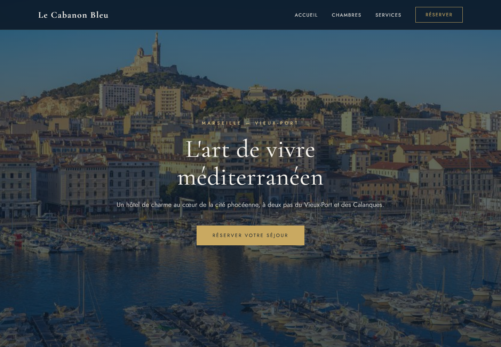
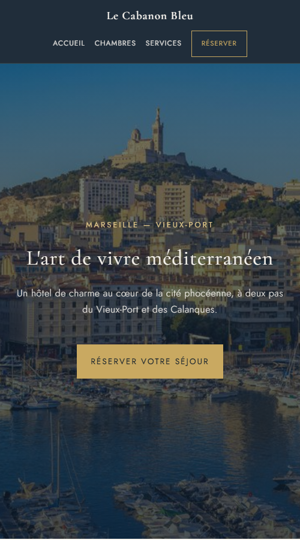

# Le Cabanon Bleu — Site vitrine d’un hôtel fictif

## Texte court pour le portfolio

Le Cabanon Bleu est un projet personnel de site vitrine pour un hôtel fictif à Marseille. Son identité visuelle, minimaliste et premium, associe le calcaire, le bleu nuit et une seule couleur d’accent, le bleu Méditerranée, à une photographie du Vieux-Port. Le site propose une découverte des chambres et des services, puis un parcours de réservation de démonstration, adapté aux ordinateurs, tablettes et téléphones.

## Objectif

Créer une expérience de visite claire et soignée, de la découverte de l’établissement jusqu’à la simulation d’une demande de réservation.

## Technologies

HTML, CSS et JavaScript natif, sans framework, sans npm ni étape de build : le site s’ouvre directement depuis index.html. Animations avec GSAP et ScrollTrigger, scroll fluide avec Lenis (chargés par CDN, versions fixes). Variables CSS, Grid, Flexbox, typographies fluides en clamp() et Google Fonts (Instrument Serif, Manrope). Images en WebP.

## Fonctionnalités et choix de réalisation

- Cinq pages : accueil, trois fiches de chambres et formulaire de réservation.
- Navigation et grilles adaptées aux petits écrans.
- Hero plein écran en plusieurs plans animés au scroll, titres révélés mot par mot, images dévoilées par masque.
- Services présentés dans une section horizontale épinglée sur ordinateur, remplacée par un carrousel tactile sur mobile.
- Boutons magnétiques sur ordinateur ; barre « Réserver » fixe sur mobile.
- Amélioration progressive : sans JavaScript ou avec « réduire les animations », tout le contenu reste lisible et utilisable.
- Validation des champs obligatoires, de l’adresse email et de l’ordre des dates du séjour.
- Confirmation de démonstration : aucune demande envoyée ni donnée de formulaire enregistrée par le site.
- Accès direct au contenu, repères de focus au clavier et respect de la préférence de réduction des animations.
- Palette de texte ajustée pour améliorer la lisibilité sur les fonds clairs et sombres.

## Captures à joindre

## Nature du projet

Projet de démonstration pour portfolio. L’établissement, les coordonnées et les offres sont fictifs. Il n’y a ni réservation réelle, ni paiement, ni envoi d’email. Ce projet illustre une réalisation front-end ; il ne revendique pas un audit complet d’accessibilité.
